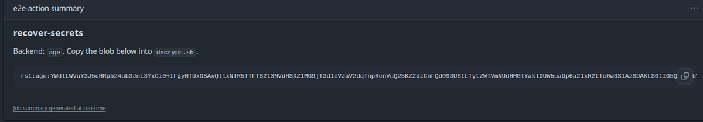
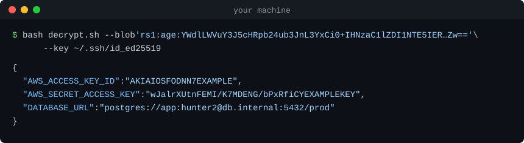

# recover-secrets

Project page: https://p-dim-popov.github.io/recover-secrets/

GitHub Actions secrets are write-only. When the person who set one has
left, or a repository moves to another organization, the usual fix is to
break the log masking with `sed` or `base64`. That leaves the plaintext in
a job log that anyone with read access can open. recover-secrets gets the
secrets out without exposing them.

recover-secrets encrypts GitHub Actions secrets to a public key you control
and prints only the encrypted blob. You decrypt the blob on your machine.
The private key never touches GitHub, so the action is safe to use on
public repositories. Run it as a GitHub Action, or run the same script
from a plain `run:` step where third-party actions are blocked.

What the workflow run shows to everyone with read access:



What `decrypt.sh` shows on your machine:



## Quick start (SSH key, throwaway branch)

1. If you do not have an SSH key on your GitHub account, add one. Find
   your public keys at `https://github.com/<user>.keys`.
2. Create a branch with the name `recover-secrets-tmp`:
   ```bash
   git switch -c recover-secrets-tmp
   ```
3. List the names of your secrets:
   ```bash
   gh secret list
   ```
   This list does not show organization secrets. Find their names under
   Settings > Secrets and variables > Actions, or run
   `gh secret list --org <org>`.
4. Add `.github/workflows/recover-secrets.yml` with this content:
   ```yaml
   name: recover-secrets

   on:
     push:
       branches: [recover-secrets-tmp]

   jobs:
     recover:
       runs-on: ubuntu-latest
       permissions:
         contents: read
       # environment: production   # only for environment-level secrets
       steps:
         - uses: p-dim-popov/recover-secrets@v1
           with:
             secrets-json: |
               {
                 "NPM_TOKEN": ${{ toJSON(secrets.NPM_TOKEN) }},
                 "DATABASE_URL": ${{ toJSON(secrets.DATABASE_URL) }}
               }
             public-key-url: https://github.com/<your-user>.keys
   ```
   Put the secrets you need in `secrets-json`, one line for each secret.
   If your organization blocks third-party actions, use the step from
   [If your organization blocks third-party actions](#if-your-organization-blocks-third-party-actions)
   instead. For the secrets of more than one environment, use the file from
   [Recover environment secrets in one run](#recover-environment-secrets-in-one-run).
5. Set `public-key-url`, or `RS_PUBLIC_KEY_URL` in the `run:` variant, to
   your own URL.
6. Commit the file and push the branch. The push starts the workflow run:
   ```bash
   git add .github/workflows/recover-secrets.yml
   git commit -m "Recover secrets"
   git push -u origin recover-secrets-tmp
   ```
7. Open the run from the Actions tab, or follow it with `gh run watch`.
   Copy the blob from the run summary.
8. Decrypt the blob on your machine:
   ```bash
   bash <(curl -fsSL https://raw.githubusercontent.com/p-dim-popov/recover-secrets/v1/decrypt.sh) --blob 'rs1:...'
   ```
   Omit `--blob` to paste the blob on stdin and press Ctrl-D. To read the
   script before you run it, download it with `curl -O` instead.
9. Delete the workflow runs of the branch, then delete the branch:
   ```bash
   gh run list --branch recover-secrets-tmp --json databaseId --jq '.[].databaseId' | xargs -n1 gh run delete
   git push origin --delete recover-secrets-tmp
   git switch - && git branch -D recover-secrets-tmp
   ```
   The first command also deletes the runs of other workflows that the
   push started.

To recover every secret without listing the names, use
`secrets-json: ${{ toJSON(secrets) }}`. GitHub can then hold the run, and
the run page says "GitHub detected that this workflow file may be
malicious". Read the workflow file, then click **Approve and run** on the
run page. Only this button approves the run.

`on: pull_request` also works. Replace the whole `on:` block with
`on: pull_request:`, then open a pull request to start the run. Close the
pull request after recovery. Pull requests from forks do not get secrets.

## Recover environment secrets in one run

A job gets the secrets of an environment only when it runs in that
environment. To recover the secrets of more than one environment in one
run, use a matrix. Use this file in step 4 of the quick start:

```yaml
name: recover-secrets

on:
  push:
    branches: [recover-secrets-tmp]

jobs:
  repo:
    runs-on: ubuntu-latest
    permissions:
      contents: read
    steps:
      - uses: p-dim-popov/recover-secrets@v1
        with:
          secrets-json: |
            {
              "NPM_TOKEN": ${{ toJSON(secrets.NPM_TOKEN) }},
              "DATABASE_URL": ${{ toJSON(secrets.DATABASE_URL) }}
            }
          public-key-url: https://github.com/<your-user>.keys

  env:
    runs-on: ubuntu-latest
    permissions:
      contents: read
    strategy:
      fail-fast: false
      matrix:
        env: [production, staging]
    environment: ${{ matrix.env }}
    steps:
      - uses: p-dim-popov/recover-secrets@v1
        with:
          secrets-json: |
            {
              "NPM_TOKEN": ${{ toJSON(secrets.NPM_TOKEN) }},
              "DATABASE_URL": ${{ toJSON(secrets.DATABASE_URL) }}
            }
          public-key-url: https://github.com/<your-user>.keys
```

Put your environment names in `matrix.env`. The first command lists them.
The second command lists the secret names of one environment:

```bash
gh api --paginate 'repos/{owner}/{repo}/environments' --jq '.environments[].name'
gh secret list --env production
```

Put the names from all environments in both `secrets-json` objects. The
blob of each job leaves out the names that are not set for that job. The
run log shows the number of names that the job left out. A job fails when
none of its names is set.

A job in an environment also gets the repository and organization secrets.
When an environment secret and a repository secret have the same name, the
job gets the environment value. Only the `repo` job gets the repository
value of that secret.

An environment with required reviewers holds its job until a reviewer
approves it. An environment restricted to protected branches rejects
`recover-secrets-tmp`. See [Security notes](#security-notes).

Each job writes its own blob to its run summary. Decrypt each blob as in
the quick start.

## Move a secret to another repository

To copy a secret into another repository, pipe the value from `decrypt.sh`
straight into `gh secret set`. The value does not show on your screen:

```bash
bash <(curl -fsSL https://raw.githubusercontent.com/p-dim-popov/recover-secrets/v1/decrypt.sh) \
  --blob 'rs1:...' | jq -j '.NPM_TOKEN' | gh secret set NPM_TOKEN --repo new-org/new-repo
```

`jq -j` writes the value without a trailing newline. `gh secret set` reads
the value from standard input when you omit `--body`. Run one pipe for each
secret.

A coding agent can run this pipe for you. The value stays out of the
agent's transcript only while the agent pipes the value and never prints
it.

Do not pipe `decrypt.sh --env` into `gh secret set -f -`. The `--env`
output uses shell quoting. When a value contains a `'`, `gh` stops with the
error "error parsing env file".

## If your organization blocks third-party actions

An organization or a repository can limit which actions a workflow may
use. The strictest setting permits only actions from the same
organization. Under that setting, `uses: p-dim-popov/recover-secrets@v1`
does not run, and `uses: actions/checkout` does not run either.

`recover.sh` at the root of this repository is the same code the action
runs, built into one file. A `run:` step can fetch it and run it. Replace
the `uses:` step from the quick start with this step. Everything else in
the quick start stays the same.

```yaml
    steps:
      - id: recover
        shell: bash
        env:
          RS_SECRETS_JSON: |
            {
              "NPM_TOKEN": ${{ toJSON(secrets.NPM_TOKEN) }},
              "DATABASE_URL": ${{ toJSON(secrets.DATABASE_URL) }}
            }
          RS_PUBLIC_KEY_URL: https://github.com/<your-user>.keys
        run: curl -fsSL https://raw.githubusercontent.com/p-dim-popov/recover-secrets/v1/recover.sh | bash
```

Keep `shell: bash`. GitHub then runs the step with `pipefail`, so a failed
download fails the step instead of running an empty script. Read the
script at that URL before you push the branch. To pin the script to
one commit, replace `v1` in the URL with a commit SHA.

The script reads the action's inputs from environment variables:
`RS_SECRETS_JSON`, `RS_PUBLIC_KEY_URL`, `RS_PUBLIC_KEY` and `RS_INCLUDE`.
The blob lands in the run log, in the step summary, and in the step output
`steps.recover.outputs.blob`. A non-empty `RS_ARTIFACT_NAME` also writes
the blob to `$RUNNER_TEMP/recover-secrets/blob.txt`. The script does not
upload it. Uploading needs `actions/upload-artifact`, which the same policy
can block. `retention-days` has no equivalent.

## Backends

| Key type | Where to get one | `public-key-url` to use | Decrypt with |
|---|---|---|---|
| age / SSH | `ssh-keygen -t ed25519`, or an existing key | `https://github.com/<user>.keys` | `decrypt.sh --key ~/.ssh/id_ed25519` (the default) |
| GPG | A GPG key with an encryption subkey | `https://github.com/<user>.gpg` | `decrypt.sh` (uses your keyring) |
| openssl RSA | `openssl genpkey -algorithm RSA -pkeyopt rsa_keygen_bits:4096 -out key.pem && openssl pkey -in key.pem -pubout -out key.pub` | A gist raw URL | `decrypt.sh --key key.pem` |

GitHub-hosted runners install `age` with `apt-get` when it is missing.
Self-hosted runners must preinstall it.

## Manual dispatch flow

If your repository keeps the workflow file on the default branch
permanently, use `workflow_dispatch` instead of `push`:

```yaml
name: recover-secrets

on:
  workflow_dispatch:
    inputs:
      public-key-url:
        description: HTTPS URL of your public key (e.g. https://github.com/<user>.keys)
        required: true
      include:
        description: Secret names or globs, comma-separated. Empty means everything.
        required: false
        default: ""
      environment:
        description: Deployment environment, for environment-level secrets
        required: false
        default: ""

jobs:
  recover:
    runs-on: ubuntu-latest
    permissions:
      contents: read
    environment: ${{ inputs.environment != '' && inputs.environment || null }}
    steps:
      - uses: p-dim-popov/recover-secrets@v1
        with:
          secrets-json: ${{ toJSON(secrets) }}
          public-key-url: ${{ inputs.public-key-url }}
          include: ${{ inputs.include }}
```

Run it from the Actions tab and fill in the form. `workflow_dispatch`
triggers a run only when the workflow file exists on the default branch.
Commit the workflow file to the default branch before you use this flow.
This workflow passes the whole `secrets` context, so GitHub can hold each
run until you click **Approve and run** on the run page.

The `environment:` line on the job makes environment-level secrets
available. Remove it if you do not use environments. The step from
[If your organization blocks third-party actions](#if-your-organization-blocks-third-party-actions)
works here too.

## `decrypt.sh` reference

```
Usage: decrypt.sh [--blob <string> | --file <path>] [--key <path>] [--env]
  no --blob/--file  read the blob from stdin (paste, then Ctrl-D)
  --key <path>      private key: SSH key or age identity (age), PEM (openssl);
                    ignored for gpg, which uses your keyring
  --env             print NAME='value' lines instead of JSON
```

`-h` / `--help` prints this text.

`--env` mode prints shell-sourceable `NAME='value'` lines instead of JSON.
Secret names must be valid shell identifiers in this mode. The script also
refuses names that change how a shell or the dynamic loader behaves
(`PATH`, `IFS`, `HOME`, `BASH_ENV`, `ENV`, `PROMPT_COMMAND`, `PS0` to `PS9`,
`SHELLOPTS`, `BASHOPTS`, `CDPATH`, `LD_*`, `DYLD_*`). In both cases the
script prints nothing and exits with an error that asks for JSON output
instead. Only decrypt blobs copied from your own workflow run. No backend
authenticates who produced a blob. Example:

```bash
(umask 077; bash decrypt.sh --file blob.txt --env > .env)
```

## Inputs and outputs

### Action (`p-dim-popov/recover-secrets@v1`)

**Inputs**

| Name | Required | Default | Description |
|---|---|---|---|
| `secrets-json` | yes | none | JSON object of the secrets to recover. Name each secret, for example `{"FOO": ${{ toJSON(secrets.FOO) }}}`. `${{ toJSON(secrets) }}` passes every secret, but GitHub can hold the run until someone approves it. |
| `public-key-url` | no | `""` | HTTPS URL of the public key to encrypt to. Accepts an SSH keys list such as `https://github.com/<user>.keys`, a GPG key such as `https://github.com/<user>.gpg`, an age1 recipient, or a PEM RSA public key. Use this or `public-key`. |
| `public-key` | no | `""` | The public key text, as an alternative to `public-key-url`. |
| `include` | no | `""` | Comma-separated secret names or globs (`AWS_*`). Empty means every secret except `github_token`, which is only included when named exactly. |
| `artifact-name` | no | `""` | If set, the action also uploads the encrypted blob as an artifact with this name. |
| `retention-days` | no | `"1"` | Retention for the artifact, in days. |

**Outputs**

| Name | Description |
|---|---|
| `blob` | The encrypted blob, `rs1:<backend>:<base64>`. Feed it to `decrypt.sh`. |

Read the output in a later step through `env:`, not inside the `run:` text:

```yaml
      - env:
          BLOB: ${{ steps.recover.outputs.blob }}
        run: echo "$BLOB"
```

## Limits

- The secrets JSON reaches the script through one environment variable.
  On Linux, a single environment string is capped at 128 KiB. Secrets
  JSON over about 128 KiB fails with the error "Argument list too long".
- GitHub caps step summaries and job outputs at 1 MiB each.

## Security notes

- The runner step makes two kinds of network calls. It fetches the public
  key from `public-key-url` over HTTPS, and it installs `age` with `apt-get`
  or `brew` when the runner lacks it. Nothing else leaves the runner.
  `recover.sh` is one file of about 400 lines. Read it before you use it.
- Under this threat model, anyone with read access to the repository can
  see the encrypted blob. The blob must be computationally useless without
  the private key. This is the only property the action promises.
- Whoever controls the key URL controls who can decrypt the blob. `.keys`
  and `.gpg` URLs on `github.com/<user>` are safer than a gist, because
  only the account holder can change them.
- The examples name each secret, such as `{"FOO": ${{ toJSON(secrets.FOO) }}}`.
  `toJSON` quotes and escapes the value, so multi-line values and quotes
  stay valid JSON. `toJSON(secrets)` passes every secret. Security scanners
  such as Datadog flag it as overprovisioning, and GitHub can hold the run
  until someone clicks **Approve and run**.
- Secret names are visible in the run log to anyone with read access to
  the repository. The runner prints each step's `with:` and `env:` inputs
  in the step header, so every name in `secrets-json` appears there. The
  values in that header rely on GitHub's secret masking. The action itself
  never writes a secret name or value. Only the names that you put in
  `secrets-json` appear there.
- After recovery, delete the branch, delete the workflow run, and rotate
  the secret if you suspect compromise.
- Environment-level secrets require the job to run in that environment.
  Set `environment:` on the job. Environments restricted to protected
  branches reject a throwaway branch. Temporarily allow
  `recover-secrets-tmp`, or use the dispatch flow from the default branch
  instead.
- `workflow_dispatch` runs only when the workflow file exists on the
  default branch, as GitHub's documentation states. This is why the
  throwaway-branch flow uses `on: push`.
- The `branches:` filter keeps this workflow from running on any other
  branch. If the file reaches another branch by mistake, the workflow does
  not run there.
- Only people with write access to the repository can push the branch.
  Only they can start the run.
- When you push the branch, GitHub also starts the other workflows whose
  `on: push` or `on: create` trigger matches the branch. Check those
  workflows before you push.
- The openssl backend has no authentication tag. The openssl CLI has no
  AES-GCM mode. Confidentiality is the goal. Integrity on decrypt means
  that the plaintext parses as a JSON object.
- The action excludes `github_token` from the secrets unless `include`
  names it exactly.
- Only decrypt blobs copied from your own workflow run. No backend
  authenticates who produced a blob. Anyone who knows the public key can
  encrypt a blob to it.
- Every `curl` command in this README fetches a script from the `v1` tag
  at run time. `recover.sh` runs on the runner and `decrypt.sh` on your
  machine. `uses: p-dim-popov/recover-secrets@v1` trusts the same tag.
  Replace `v1` in a URL with a commit SHA to pin that script.

## Development

This project requires `make`, `age`, `gpg`, `openssl`, `jq`, `shellcheck`,
and `actionlint`.

The code lives in `source/`. The two scripts at the root, `recover.sh` and
`decrypt.sh`, are built from it. Do not edit them directly. After you edit
a file in `source/`, rebuild them:

```bash
make
```

`recover.sh` writes the files from `source/` into a temporary directory
and runs `main.sh` from there. `decrypt.sh` is `source/decrypt.sh` with
`detect.sh` pasted at its include marker. `make check` fails when the root
scripts are out of date. CI runs it.

Run the test suite:

```bash
bash tests/run.sh
```

## Release checklist

1. Run `make check` and `bash tests/run.sh`.
2. Tag the release and move `v1`. The `uses:` reference and both `curl`
   URLs serve whatever `v1` points to:
   ```bash
   git tag vX.Y.Z && git tag -f v1 && git push origin vX.Y.Z && git push -f origin v1
   ```
3. Create a GitHub release from the new tag.
4. On the first release, tick "Publish this Action to the GitHub
   Marketplace".

## License

MIT. See [LICENSE](LICENSE).
